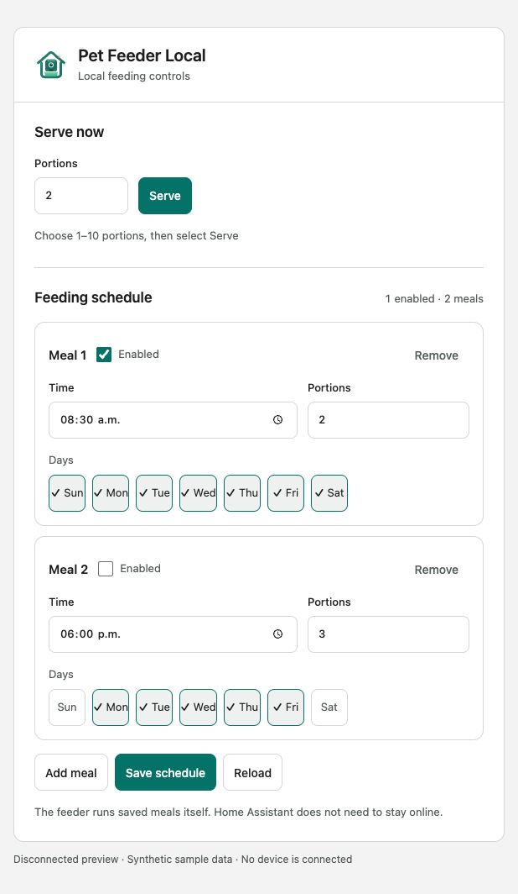
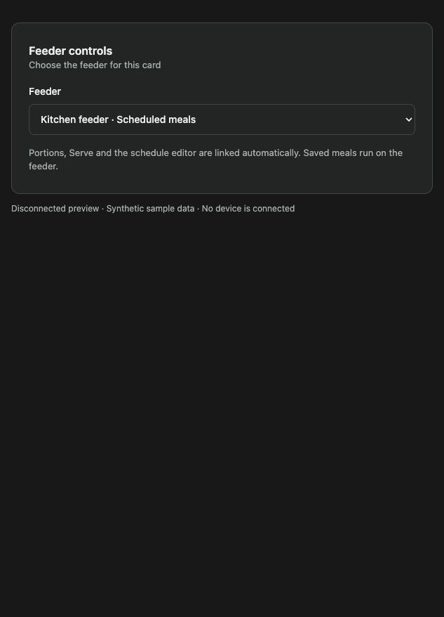

# Pet Feeder Local for Home Assistant


[](https://my.home-assistant.io/redirect/marketplace_repository/?owner=e2equiel&repository=ha-pet-feeder-local&category=integration)
[](https://my.home-assistant.io/redirect/config_flow_start/?domain=pet_feeder_local)

**1. Add and download the repository in Marketplace. 2. Set up the integration with your feeder's local address and private token.** If you still use HACS, the [HACS shortcut](https://my.home-assistant.io/redirect/hacs_repository/?owner=e2equiel&repository=ha-pet-feeder-local&category=integration) opens the appropriate repository page. Requires HA 2026.11.2 or later.

[](https://github.com/e2equiel/ha-pet-feeder-local/actions/workflows/validate.yml)

Choose portions, press **Serve**, edit the feeder's own weekly meals, and view its local camera. This integration connects directly to the [Pet Feeder Local firmware overlay](https://github.com/e2equiel/pet-feeder-local-firmware). It needs no Tuya account, Tuya local key, developer subscription or tuya-local integration.



*Preview of the actual bundled card using synthetic demonstration data; no home-camera image or household schedule is published.*



**Experimental, tested with V330L-DU4L-VS / original application 68.00.09.** Install the supported overlay first. It retains proprietary camera/MCU components while providing independent local controls. Physical food delivery, battery operation and complete-power-loss clock retention still require observation on your own device. See [validation and limitations](docs/validation.md).

## Installation

Requires **Home Assistant 2026.11.2 or later** and a feeder running the companion overlay's API v1. Tested baseline: HA 2026.11.2, Python 3.14.

1. **Install the feeder overlay.** Follow its [guided installer](https://github.com/e2equiel/pet-feeder-local-firmware#install-in-four-steps). One-time Tuya/Smart Life Wi-Fi pairing is the validated starting point. Keep the local API address and private token from the completion page.
2. **Import this custom repository into Marketplace.** Open [Add Pet Feeder Local to Marketplace](https://my.home-assistant.io/redirect/marketplace_repository/?owner=e2equiel&repository=ha-pet-feeder-local&category=integration). Confirm your HA instance, add/download the repository, then restart HA if Marketplace requests it. Alternatively, use Marketplace → Custom repositories, enter `https://github.com/e2equiel/ha-pet-feeder-local` and select the Integration category. Older installations using HACS can add the same URL as a custom Integration repository. This project is prepared for custom import; default-catalog listing requires separate community review.
3. **Add the integration.** Under Settings → Devices & services, select a discovered **Pet Feeder Local**, or use [Add integration](https://my.home-assistant.io/redirect/config_flow_start/?domain=pet_feeder_local). Enter the address such as `http://192.168.1.123:8080` and the private API token. The optional shared stream URL can be left empty for HA alone; for Frigate too, see [camera setup](docs/camera.md).
4. **Add the controls.** Edit a dashboard → Add card → choose **Pet Feeder Local** → choose your feeder in the visual editor. Save. The card is bundled and loaded automatically; no resource URL, file copying or YAML is needed. Entity links may take one polling interval (30 seconds) to appear just after setup.
5. **Review and save meals.** Select weekdays, local time and portions, then enable the desired rows and press **Save schedule**. New rows start disabled. The device verifies its saved table before the editor reports success. Observe actual meals before relying on the modified feeder.

For a manual installation, copy the entire `custom_components/pet_feeder_local` directory into your HA configuration's `custom_components` directory, restart HA, and continue at step 3. The frontend and brand assets must stay inside that component folder.

## Daily use

Changing **Portions** only selects an integer from 1 to 10. **Serve** is the separate action that sends one feeding request. A timeout means the result may be unknown: the integration does not repeat the request. Check the feeder before serving again. An MCU acknowledgement confirms the protocol exchange, not the mass of food in the bowl.

The editor supports up to eight MCU meal rows, including disabled rows. Unsaved edits remain in the browser. Saving replaces the complete table with a fresh revision check and exact readback; if another client changed it, reload before editing again. The calendar entity displays enabled weekly meals; edit them in the card. Saved meals execute on the MCU with valid power and clock, including while HA or Wi-Fi is offline.

HA polls status and schedules every **30 seconds**. While connected, it synchronizes the MCU's wall clock to HA's configured timezone every **five minutes**. HA does not create feeding automations. A timezone or DST change cannot reach a disconnected MCU; recovery after complete power loss remains unverified.

| Entity | Purpose | Default |
| --- | --- | --- |
| Portions | Select 1–10 portions without feeding | Enabled |
| Serve | Explicit manual feeding | Enabled; unavailable if MCU/feeding unavailable |
| Scheduled meals | Row count and editor attributes | Enabled |
| Feeding schedule | Read-only calendar of enabled MCU meals | Enabled |
| Camera | Authenticated local HEVC video | Enabled |
| MCU connection | Observed serial connectivity diagnostic | Disabled; enable in the device's entities if desired |

HA uses one stream worker for stills and live video. HEVC playback depends on the browser/device. One native reader is supported per feeder stream; use a shared go2rtc source for HA and Frigate. Audio is not implemented. [Camera and Frigate example](docs/camera.md).

## Connection changes and troubleshooting

Use the integration entry's **Reconfigure** option to change its address, token or optional restream URL. HA validates the original device identity before updating existing entities. An invalid token starts a reauthentication flow. SSDP discovery updates a known feeder's LAN address; multicast may not cross VLANs, so manual setup and DHCP reservations remain useful.

A lost API connection makes entities unavailable and logs one failure/recovery transition. A reachable service with an MCU connection fault creates a Repairs issue that clears after recovery. Check the feeder's power and LAN connection before resuming manual serving. Invalid schedules, conflicts, unknown feeding outcomes and connection failures return translated, actionable errors.

- **Cannot connect:** include `http://` and port `8080`; confirm the overlay is installed and the IP is reachable from HA.
- **Token rejected:** retrieve it from the installer's private `home-assistant-setup.json`, then reauthenticate. Never post that file publicly.
- **Wrong feeder:** the new address belongs to another device; choose the original one. Create a separate entry for each feeder.
- **Card missing:** restart HA after the initial download, refresh the browser, then check the card picker. Remove any legacy 0.1 manually added card resource before using 0.2's bundled card; old dashboard configurations with three explicit entity IDs remain supported.
- **Schedule conflict:** reload the card and edit the current MCU table. Do not blindly resend a stale table.
- **Video fails:** check HEVC support and the shared stream configuration. A second direct viewer replaces the native reader.

[Download diagnostics](https://www.home-assistant.io/integrations/diagnostics/) from the integration entry when reporting a bug. This integration's diagnostics include model/version, connectivity and row counts. They deliberately omit tokens, addresses, device identity, meal times, raw API responses and video.

## Actions and automation examples

The integration exposes `pet_feeder_local.set_schedule` to replace up to eight rows. The bundled editor is the easiest interface. The action requires a loaded `config_entry_id`, the sensor's freshly read `revision`, and meal objects with `weekdays` (Sunday bit 0), `hour`, `minute`, `portions` and `enabled`. It detects conflicts and verifies readback. See [action reference and examples](docs/actions.md).

Use standard HA `number.set_value` and `button.press` to automate an **explicit** manual serve when that is what you intend. There are no integration-specific triggers or conditions; standard state triggers and conditions can use its entities. Do not create an HA timed automation to duplicate a saved MCU meal.

## Remove the integration

Delete the entry under Settings → Devices & services. Existing MCU meals remain on the feeder and continue independently. Remove any dashboard card referring to deleted entities. Uninstall the repository from Marketplace and restart HA to remove its code. To return the device itself to Tuya/stock operation, use the firmware wizard's **Restore stock operation**; deleting the HA entry alone does not undo the device overlay.

## Quality and development

Marketplace integrations are classified as **Custom**. Official Platinum is a Core integration tier; this project does not claim an official award. [Quality assessment](docs/quality.md) maps every applicable rule to code, tests or documentation, with explicit exemptions for the single fixed device model. The project uses fully asynchronous, session-injected I/O, strict typing, translated flows/entities/actions, reauthentication/reconfiguration, discovery, diagnostics, Repairs and unload support.

```sh
# Python 3.14; isolated virtual environment recommended
uv pip install -r requirements-test.txt
pytest
python tools/check_coverage.py
mypy
ruff check custom_components
npm install
npm test
```

Tests use the official `pytest-homeassistant` package matching HA 2026.11.2 and require no cloud or hardware. Coverage must exceed 95% for **each** integration module. GitHub Actions also runs the official hassfest and Marketplace/HACS validators, without ignoring checks. The dependency API client is included, typed and asynchronous; it is not currently published as a separate PyPI package.

[Contributing](CONTRIBUTING.md) · [Security](SECURITY.md) · [MIT license](LICENSE) · [Firmware project](https://github.com/e2equiel/pet-feeder-local-firmware)
