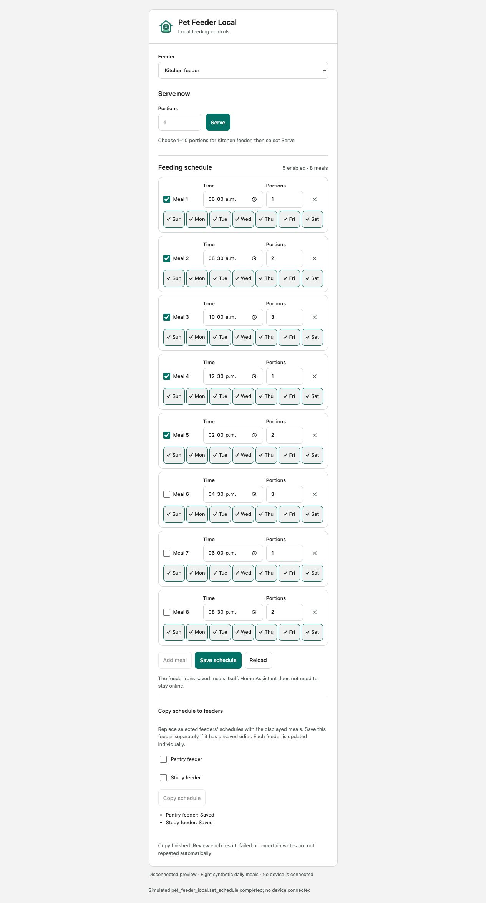

# Actions and examples

## Two-step manual serving

For an intentional manual command, set the selected number, then press the separate button. Replace example entity IDs with your own. Merely running the first action never serves food. If the second action reports an unknown outcome, inspect the feeder; do not automatically retry it.

```yaml
sequence:
  - action: number.set_value
    target:
      entity_id: number.pet_feeder_local_portions
    data:
      value: 2
  - action: button.press
    target:
      entity_id: button.pet_feeder_local_serve
```

## MCU schedule action

The visual card reads the scheduled meals sensor, keeps its revision while you edit, and sends one `pet_feeder_local.set_schedule` action. For scripts, use the same fields:

```yaml
action: pet_feeder_local.set_schedule
data:
  config_entry_id: YOUR_INTEGRATION_ENTRY_ID
  expected_revision: "COPY_THE_SENSOR_REVISION"
  meals:
    - weekdays: 62
      hour: 8
      minute: 30
      portions: 2
      enabled: false
```

`62` selects Monday–Friday (Sunday bit 0); `127` selects every day. The example starts disabled. The action replaces the entire table, including disabled rows, and allows at most eight entries. Keep any existing rows you want to retain. A changed revision is rejected, and a mismatch between requested meals and the MCU readback is reported as an error. Never substitute a stale hard-coded revision in a recurring automation.

## Use cases

- Adjust a weekly meal directly on the feeder, then leave HA off without moving the timer into HA.
- Serve an additional meal deliberately with two separate controls.
- Display upcoming enabled meals in HA's standard calendar card.
- Record the local camera in Frigate using a shared go2rtc connection.
- Alert on availability or the optional MCU connectivity diagnostic using standard HA state triggers and conditions.

No integration-specific triggers or conditions are registered. Camera use does not require a Tuya stream acquisition service.

## Several feeders in one card

Use the visual editor to choose a default feeder and check the other installed Pet Feeder Local devices. Equivalent YAML:

```yaml
type: custom:pet-feeder-local-card
schedule_entity: sensor.kitchen_feeder_scheduled_meals
schedule_entities:
  - sensor.kitchen_feeder_scheduled_meals
  - sensor.pantry_feeder_scheduled_meals
```

Switching preserves each feeder’s browser draft. Portions and Serve always link to the selected device. A single-device card and legacy explicit entity links remain supported.

Expand **Copy schedule to feeders**, check destinations, and press **Copy schedule**. Nothing is checked by default. Review the confirmation: the displayed rows and their enabled flags replace the entire table on each destination. The source draft is not saved by copying. Save or discard a destination’s unsaved draft first. All selected destinations must initially be available with distinct integration entries and current revisions. Each write has its own conflict/readback check. A runtime failure can leave some devices updated and others unchanged or uncertain; review each result before taking further action. There is no automatic retry.

Multi-feeder interactions are tested with synthetic devices. Hardware tests in this project act on one test feeder only.



## Weekday encoding

HA action, sensor and calendar masks use Sunday bit 0 through Saturday bit 6: Tuesday is `4`, Sunday is `1`, daily is `127`. The supported MCU’s raw firmware API v1 uses the reverse seven-bit order: Tuesday is `16`, Sunday is `64`. The client translates on read and write and keeps the raw server revision unchanged. Do not reverse masks yourself when calling the HA action.

Version 0.3 and earlier passed raw masks through. After upgrading, review weekday-specific schedules; they are not automatically rewritten. The hardware comparison directly exercised Tuesday and Wednesday. Remaining individual days follow the inferred bit-order model and have software regression coverage, not separate physical trials.
