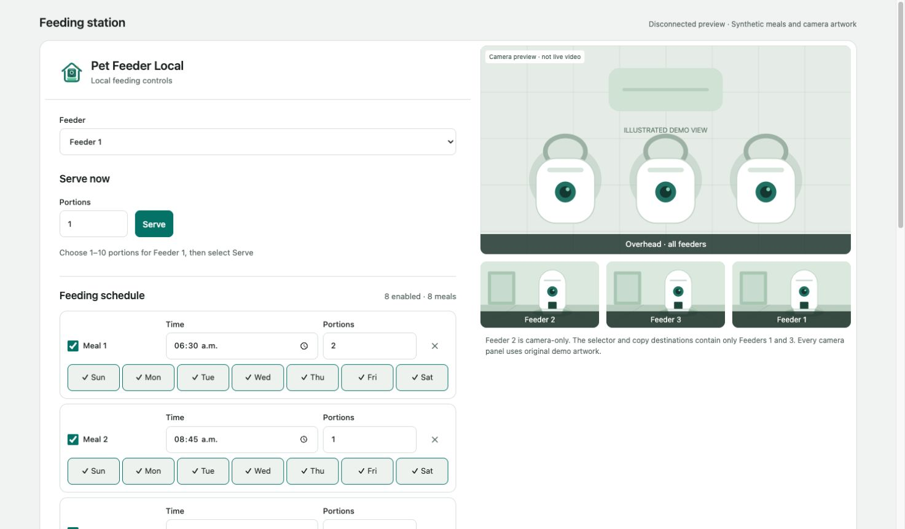
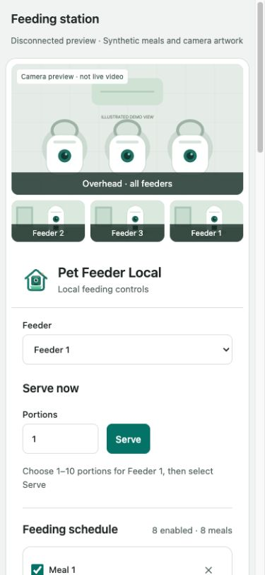
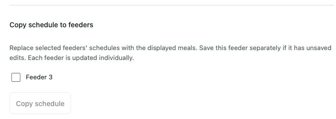

# One control card, four local camera views

This layout selects between two active feeders while keeping an overhead camera and all three feeder cameras visible. The third feeder is camera-only: it is not included in the control selector or copy destinations. The control card is the integration's bundled card, not a second feeding integration.



*Disconnected preview of the actual bundled controls. Meals and camera illustrations are synthetic. No home image, address, token or household schedule is included.*

## Start with the visual editor

1. Install and observe each selected feeder separately. Give the devices distinct display names in HA so that the selector and copy confirmation identify them clearly.
2. Edit a dashboard, add **Pet Feeder Local**, and choose the two active devices under **Feeders in this card**. Choose the default feeder. The selector changes both the schedule editor and the target of **Serve**.
3. Save the **dashboard**. This does not save a meal table or send food. You do not need to press **Save schedule** just to add the card.
4. Add existing camera entities using HA's Picture Entity card if you prefer the standard dashboard layout. Use local shared streams when the cameras also feed Frigate; see [camera setup](camera.md).

The bundled feeding card needs no separate frontend package. The single-card composition pictured here optionally uses [Layout Card](https://github.com/thomasloven/lovelace-layout-card) and [Stack In Card](https://github.com/custom-cards/stack-in-card). Install those two dashboard components through your dashboard-card manager before using the following recipe. No new firmware is required.

## Use the pictured single-card layout

1. Download or copy [`examples/unified-dashboard-card.yaml`](examples/unified-dashboard-card.yaml).
2. Replace its **two schedule sensor IDs and four camera entity IDs** with your own. These are placeholders, not names that HA necessarily creates. Find the real names in Settings → Devices & services → Entities. The Pet Feeder Local visual editor can also generate the correct `schedule_entity` / `schedule_entities` values for your chosen feeders.
3. In a new dashboard view, choose **Panel** layout. Add a Manual card and paste the recipe. It is one composite card containing one feeding card and the four camera panels.
4. Save the dashboard and refresh the browser if a newly installed dashboard component is not loaded yet. Do not press Serve, Save schedule or Copy schedule as an installation check.

On a wide screen the controls are beside the camera group. On a narrow screen the cameras appear first, followed by the feeder selector and controls. Tapping a camera opens its HA detail view. The example's three thumbnails are ordered 2, 3, 1; change their order or display names to suit your setup without changing any feeding configuration.



*390×844 CSS-pixel preview. The four panels use local demo artwork; they do not represent connected cameras.*

## Choose which feeder to control

Select the intended feeder before choosing portions or editing meals. The help text under Serve names the current target. Changing a portion number only selects a quantity; **Serve** is the separate action that dispenses it. Schedule drafts remain separate when switching feeders. Existing saved meals continue to run on their own devices.

## Copy only when you intend to replace a calendar

1. Select the source feeder. The displayed meals, including their enabled flags, are the source for the copy. Unsaved displayed edits are included, so review them first.
2. Open **Copy schedule to feeders** below the schedule editor.
3. Explicitly check the destination. No destination is selected by default, and the source cannot be its own destination. A feeder excluded from this card cannot receive the copy.
4. Press **Copy schedule**, review the named destination and row count, and confirm only if replacing that feeder's entire table is intended.
5. Review the per-feeder result and the destination's saved schedule. The source's unsaved edits are not saved by copying. A stale revision, dirty destination draft or uncertain write requires review; the card does not retry an uncertain request.



*The unchecked destination and disabled Copy button shown here are real bundled-card behavior with synthetic data. No calendar was copied to make this screenshot.*

The live deployment checked both selector directions, correct copy destinations, all four playing videos and exact preservation of the two eight-row schedules. **No copy was executed on the active household feeders.** Actual copy requests, cancellation and partial failures are covered by disconnected tests; see [validation](validation.md#three-device-supervised-validation-2026-11-25).

## Reproduce the public previews

From the integration repository root, developers can run a static loopback server with an existing Python installation:

```sh
python3 -m http.server 8088 --bind 127.0.0.1
```

Open `http://127.0.0.1:8088/tools/preview/unified-dashboard.html` for the desktop/mobile preview, or add `?copy` to show the copy panel. The page imports the repository's actual bundled card, supplies only synthetic state, and rejects every service action locally. It contains no HA credentials or device addresses. Its camera artwork is original SVG. This optional documentation preview is separate from the native Mac installer, which needs no Python runtime.
